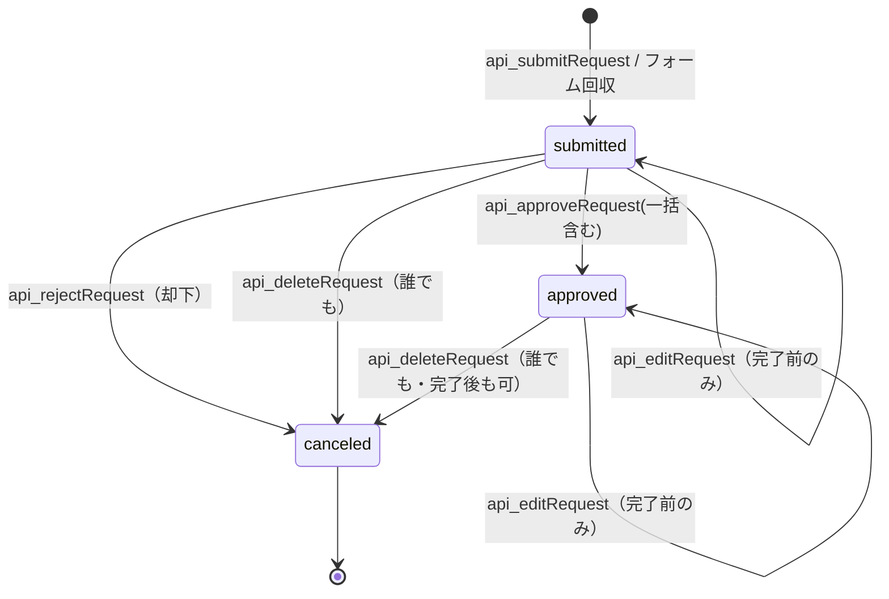

# 移行棚卸し 01：業務ロジックとサーバー入口

対象：残業・休日出勤申請 GAS アプリ（`src/`）。VPS（FastAPI＋PostgreSQL＋worker）へ移すとき、ここに書いた動きを**癖も含めて同じに**再現します。この文書は受け入れ確認表として使います。

- 調べたファイル（全行を読んだもの）：`approval.gs` `worklog.gs` `formSubmit.gs` `api.gs` `adminApi.gs` `staffSummaryApi.gs` `deptAuth.gs` `masters.gs` `config.gs`
- 呼び先の確認のために一部を読んだもの：`mail.gs`（WorkLogs 読み込み・蓄積SS）、`pdfExport.gs`（PDF 生成の入口と前提）、`formMap.gs`（`api_getFormUrl`・`api_getHolidayCandidateDates`）、`appsscript.json`、各 `.html` の `google.script.run` 呼び出し
- 表記：**確認済み**＝コードで読んだこと。**推測**＝GAS の仕様やコードの流れから推し量ったこと（本番で確かめる必要あり）。
- 行番号は 2026-11-26 時点の作業ツリー（最新コミット `ca2ecac`）のものです。

---

## 0. 移行で最初に押さえること（要点）

| # | 内容 | 根拠 | 確かさ |
|---|---|---|---|
| 1 | Web アプリは「実行ユーザー＝デプロイした人」「アクセス＝誰でも（匿名可）」で公開されている | `appsscript.json` `webapp.executeAs: USER_DEPLOYING`, `access: ANYONE_ANONYMOUS` | 確認済み |
| 2 | このため匿名やドメイン外の利用者では `Session.getActiveUser().getEmail()` が空文字になる | GAS の仕様 | 推測（GAS 公式仕様に基づく） |
| 3 | **メールが空だと管理者扱いになる箇所がある**（`api_getApproverDashboard`） | `approval.gs:135` `const admin = !email \|\| isAdmin_(email);`、例外時も `isAdmin: true`（`approval.gs:273`） | 確認済み |
| 4 | 申請の作成・編集・削除（キャンセル）、全社ダッシュボード、スタッフ集計には**権限チェックが一切ない** | `formSubmit.gs:678` `worklog.gs:540` `worklog.gs:652` `worklog.gs:404` `staffSummaryApi.gs:57` | 確認済み |
| 5 | 末尾が `_` でない最上位関数は、すべてブラウザから `google.script.run` で呼べる。保守用関数（蓄積SS再構築、マスタ同期、休憩再計算など）も無認証で呼べる | 一覧は §1.3 | 確認済み（関数の存在）／推測（呼べること＝GAS 仕様） |
| 6 | 外部 API（Sebastian）は `doPost`。JSON 本文の `token` をスクリプトプロパティ `SEBASTIAN_API_TOKEN` と比べるだけで、本人確認なし。任意の requestId を完了にできる | `api.gs:10-61` | 確認済み |
| 7 | Sebastian の残業完了は**休憩の計算方法が画面と違う**（休憩マスタ方式）。開始時刻の作り方・PDF の作り方も画面と違う | `api.gs:86-89` と `worklog.gs:159,170` | 確認済み |
| 8 | 「年度」の定義が 2 種類ある。申請の日付チェック・蓄積SS・スタッフ集計は 3/16 始まり、総務画面の年度推移と特別条項回数は 4/1 始まり | `config.gs:108-117`、`adminApi.gs:11-23,329` | 確認済み |
| 9 | ステータスは `submitted` / `approved` / `canceled` の 3 つだけ。却下と削除はどちらも `canceled`。`modified` は廃止済み（`5aa4621`）。二次承認は別列 `approvedBy2/approvedAt2` | §2 | 確認済み |

---

## 1. サーバーの入口

### 1.1 doGet（画面の振り分け）`adminApi.gs:534-598`

| 項目 | 内容 | 確かさ |
|---|---|---|
| `page` の既定値 | 無指定なら `'top'`（`adminApi.gs:535`） | 確認済み |
| 許可するページ | `top` `approver` `admin` `approve2` `staffSummary`。それ以外は `top` に落とす（`adminApi.gs:544-545`） | 確認済み |
| `page=redirect` | `handleFormRedirect_(e)` へ（`adminApi.gs:539-541`）。下表参照 | 確認済み |
| `admin` / `approve2` の権限 | `isAdminWithDebug_(email)` が false なら `no_auth` 画面（`adminApi.gs:548-564`） | 確認済み |
| `no_auth` のメッセージ（admin/approve2） | `'総務部（管理者）権限がありません。\nApproverMap シートに role=admin で登録されているか、\nSettings シートの ADMIN_EMAILS にメールアドレスが含まれているか確認してください。\n（現在のアカウント: ' + (email \|\| '取得不可') + '）\n\n--- デバッグ情報 ---\n' + adminResult.debug`（`adminApi.gs:555-559`）。**デバッグ情報に Settings の ADMIN_EMAILS / GENERAL_AFFAIRS_EMAILS の生値と ApproverMap のヘッダが含まれる**（`approval.gs:21-22,41,48`）。メール空のときは `'email が空です'` だけ | 確認済み |
| `approver` の権限 | メールが**空でなければ**、管理者か、`getDeptApproverMap_()` のどこかの部署に自分のメール（小文字）があるかを見る。無ければ `no_auth`（`adminApi.gs:567-585`）。**メールが空なら検査を飛ばして承認者画面を表示する**（`adminApi.gs:569`） | 確認済み |
| `no_auth` のメッセージ（approver） | `'承認者権限がありません。\nDeptApprovers または ApproverMap に登録されているか確認してください。\n（現在のアカウント: ' + email + '）'`（`adminApi.gs:579`） | 確認済み |
| `top` `staffSummary` | 権限チェックなし | 確認済み |
| テンプレート変数 | `APP_URL`＝`ScriptApp.getService().getUrl()`、`PORTAL_URL`＝固定 URL（`adminApi.gs:554,578,589` の 3 か所に同じ値を直書き）、`DATE_PARAM`＝`?date=` の値そのまま（無ければ `''`）、`REASONS_JSON` `OT_HOURS_JSON` `HD_HOURS_JSON`（`adminApi.gs:588-593`） | 確認済み |
| `date` の使い道 | `admin.html:466-469,1030`（日次一覧の初期日付）、`approve2.html:256`（二次承認の対象日）。サーバー側では検証しない | 確認済み |
| 画面タイトル | 通常 `'残業・休日出勤申請'`、権限エラー `'権限エラー'` | 確認済み |
| iframe 埋め込み | すべて `XFrameOptionsMode.ALLOWALL`（社内ポータルに埋め込むため） | 確認済み（目的は推測） |

`?page=redirect`（`handleFormRedirect_` `adminApi.gs:611-657`。旧 Google フォーム方式の名残）

| 条件 | 返す内容 |
|---|---|
| `type` が `overtime` / `holiday` 以外 | `
エラー: type パラメータが不正です（overtime / holiday）
` |
| `dept` 無し | `api_getWorkerInfo()` で作業員マスタの Googleアカウント列から部署を引く。引けなければ「部署が指定されていません」画面（タイトル `部署未指定`） |
| `api_getFormUrl(type, dept)` が null | 「〇〇申請フォームを準備できませんでした」画面（タイトル `フォーム未設定`） |
| 成功 | `window.top.location.href=フォームURL` の HTML |

注意：`api_getFormUrl` はフォームが無ければ**自動生成する**（`formMap.gs:116-120`）。無認証で呼べます（確認済み）。

### 1.2 doPost（Sebastian 外部 API）`api.gs:10-264`

| 項目 | 内容 | 確かさ |
|---|---|---|
| 受け取り | `e.postData.contents` を JSON として読む。本文が無ければ `'{}'` | 確認済み |
| 認証 | 本文の `body.token` とスクリプトプロパティ `SEBASTIAN_API_TOKEN` を `!==` で比べる（定数時間比較ではない）。ヘッダ認証なし（`api.gs:18-24`） | 確認済み |
| 応答 | すべて HTTP 200 の `application/json`。失敗も `{error: ...}` で返す（`api.gs:63-67`） | 確認済み（200 固定は GAS ContentService の仕様からの推測） |
| ロック | 各アクションで `LockService.getScriptLock().waitLock(20000)` | 確認済み |
| 本人確認 | なし（`assertSelf_` を意図的に省略、`api.gs:70,132,172`） | 確認済み |

エラー文字列（そのまま再現が必要）

| 状況 | 返す JSON |
|---|---|
| JSON 解析失敗 | `{"error":"invalid JSON: <例外メッセージ>"}` |
| トークン未設定 | `{"error":"server misconfigured: SEBASTIAN_API_TOKEN not set"}` |
| トークン不一致 | `{"error":"unauthorized"}` |
| requestId 無し | `{"error":"requestId is required","action":"<action>"}` |
| 未知の action | `{"error":"unknown action: <action>","action":"<action>"}` |
| 申請が無い | `申請が見つかりません: <id>` |
| 種別違い | `残業申請ではありません: <id>` / `休日出勤申請ではありません: <id>` |
| キャンセル済み | `キャンセル済みの申請です: <id>` |
| 休日開始が無い | `休日開始が記録されていません（先にstartを実行してください）: <id>` |
| ロック待ち切れ等その他の例外 | `{"error":"<例外メッセージ>","action":"<action>"}` |

アクション一覧

| action | 入力 | 処理 | 返す JSON |
|---|---|---|---|
| `ping` | なし | なし | `{ok:true, pong:"<ISO8601 UTC>"}` |
| `completeOvertime` | `requestId` | `sebastian_markOvertimeDone_`（`api.gs:73-129`）。下記の違いに注意 | `{ok, requestId, workerName, targetDate, actualMinutes, breakMinutes, netMinutes, status, pdf}` |
| `markHolidayStart` | `requestId`, `manualStartTime`（`HH:mm`、任意） | `sebastian_markHolidayStart_`（`api.gs:135-169`） | `{ok, requestId, workerName, targetDate, actualStartAt}` |
| `markHolidayDone` | `requestId`, `manualEndTime`（`HH:mm`、任意） | `sebastian_markHolidayDone_`（`api.gs:177-257`） | `{ok, requestId, workerName, targetDate, actualStartAt, actualEndAt, actualMinutes, breakMinutes, netMinutes, status, pdf}` |

- `targetDate` は Requests の生値をそのまま返します。シートで Date 型になっていれば `JSON.stringify` で UTC の ISO 文字列（JST 0 時なら前日 `15:00:00.000Z`）、文字列ならそのまま。（確認済み：生値を返す／推測：シート上の型）
- `pdf` は `null`（未承認のとき）、`generatePdfForRequest_` の戻り値（`{ok:true,pdfFileId,pdfName,folderId}` か既存なら `{already:true,pdfFileId}`）、失敗時 `{error:"..."}`。
- `workerName` は正規化しない生値（`worklog.gs:66`）。

画面版（`api_markOvertimeDone`）との違い（すべて確認済み）

| 観点 | 画面 `api_markOvertimeDone` | Sebastian `completeOvertime` |
|---|---|---|
| 開始時刻 | `targetYmd + 'T17:20:00+09:00'`（`worklog.gs:159`） | `new Date(y, m, d, 17, 20, 0)`（実行環境の TZ 依存、`api.gs:86`） |
| 終了時刻 | 手入力 `HH:mm` か現在時刻 | 常に現在時刻（手入力なし） |
| 休憩 | `calcBreakByClockTime_`（時刻窓方式） | `calcBreakMinutesByMaster_('overtime', actualMinutes)`（休憩マスタ方式、`api.gs:89`） |
| PDF | `PDF_MODE` に `direct` を含めば `generatePdfDirect_`、そうでなければ `generatePdfForRequest_`。計算値を `wlOverride` で渡す | 常に `generatePdfForRequest_(requestId)`、`wlOverride` なし、書き込み後の `flush` なし |
| updatedBy | 利用者メールか `'unknown'` | `'sebastian-agent'` |

休日の開始・完了は画面版とほぼ同じ計算です（休憩は時刻窓方式）。ただし PDF は常に `generatePdfForRequest_`、`wlOverride` なしです（`api.gs:229-235`）。

### 1.3 ブラウザから呼ばれる関数（google.script.run）

画面が実際に呼んでいる関数（確認済み、呼び出し行）

| 関数 | 呼ぶ画面 |
|---|---|
| `api_getWorkerInfo` | `top.html:685` `staffSummary.html:496` |
| `api_getDeptList` | `top.html:688` `staffSummary.html:499` |
| `api_getWorkersByDept` | `top.html:723` `staffSummary.html:303,458,492` |
| `api_getHolidayCandidateDates` | `top.html:792,1816` |
| `api_getOrderList` | `top.html:837,1763` |
| `api_getFormUrl` | `top.html:970` |
| `api_getDashboard` | `top.html:1015` |
| `api_markOvertimeDone` | `top.html:1310,1336` |
| `api_markHolidayStart` | `top.html:1352,1375` |
| `api_markHolidayDone` | `top.html:1400,1426` |
| `api_editRequest` | `top.html:1521` |
| `api_deleteRequest` | `top.html:1544` |
| `api_submitRequest` | `top.html:2029` |
| `api_getApproverDepts` | `approver.html:486` |
| `api_getApproverDashboard` | `approver.html:567` |
| `api_approveRequest` | `approver.html:799` |
| `api_rejectRequest` | `approver.html:820` |
| `api_approveRequestsBatch` | `approver.html:899` |
| `api_approverMonthlySummary` | `approver.html:959` |
| `api_getSecondaryApprovalList` | `approve2.html:281` |
| `api_secondaryApprove` | `approve2.html:422` |
| `api_secondaryApproveBatch` | `approve2.html:455` |
| `api_adminDeptOptions` | `admin.html:482` |
| `api_adminMonthlySummary` | `admin.html:599` |
| `api_adminDailyDetail` | `admin.html:651` |
| `api_adminManualComplete` | `admin.html:702` |
| `api_adminFiscalTrend` | `admin.html:716` |
| `api_adminSpecialClauseCount` | `admin.html:987` |
| `api_adminPendingWatch` | `admin.html:1021` |
| `api_getClosingSummary` | `staffSummary.html:319` |

画面からは呼ばれていないが、ブラウザから呼べてしまう公開関数（名前が `_` で終わらない最上位関数、確認済み。呼べることは GAS 仕様からの推測）

| 関数 | 場所 | 中身 | 権限チェック |
|---|---|---|---|
| `api_getTodayRequestsForDept` | `approval.gs:80` | 旧 API。部署の本日分＋年度内の未承認過去分 | `canApproveDept_` あり |
| `api_getTodayRequestsForWorker` | `worklog.gs:348` | 旧 API。workerCode 空なら本日の全申請 | **なし** |
| `recalcWorkLogsBreakMinutes` | `worklog.gs:712` | WorkLogs 全行の休憩・実働を再計算して上書き | **なし** |
| `rebuildAccumulationSS` | `mail.gs:943` | 蓄積SSを作り直す | **なし** |
| `migrateAccumulationTimeColumns` | `mail.gs:806` | 蓄積SSの列移行 | **なし** |
| `syncAllMasters` / `testSyncWorkerOneRow` | `syncMasters.gs:28,237` | マスタ転記 | **なし** |
| `buildAllDeptForms` | `menu.gs:57` | 部署別フォーム生成 | **なし** |
| `ensureCompanyCalendarSheet` | `menu.gs:228` | カレンダーシート初期化 | **なし** |
| `forceRegeneratePdf` `debugPdfReason` `debugStampData` | `pdfExport.gs:743,631,875` | PDF 再生成・調査 | **なし**（UI ダイアログ前提なら Web からは失敗する可能性。推測） |
| `onOpen` | `menu.gs:3` | メニュー作成 | なし（Web からは失敗。推測） |

移行では、これらを Web の入口に出さない（管理者専用 CLI か worker に回す）ことを推奨します。

### 1.4 各関数の詳細

表の「権限」は、サーバー側で実際に行う検査です。画面側の表示制御は含みません。

#### 申請者向け（top.html）

| 関数 | 引数 | 戻り値 | 権限 | 副作用 | ロック | エラー文（原文） |
|---|---|---|---|---|---|---|
| `api_getDeptList()` `deptAuth.gs:117` | なし | 部署名の配列（作業員マスタの部署列の重複なし、JS 既定ソート `masters.gs:3-8`） | なし | なし | なし | `作業員マスタのヘッダが想定と違います（作業員コード/氏名/部署）。` |
| `api_getWorkersByDept(dept)` `deptAuth.gs:125` | 部署名 | `["A001 氏名", ...]`（コード順ソート）。dept 空なら `[]` | なし | なし | なし | 同上 |
| `api_getWorkerInfo()` `masters.gs:141` | なし | `{workerCode, workerName, dept, email}` か `null`。作業員マスタの「Googleアカウント」で始まる列と**大文字小文字を区別して完全一致**（`masters.gs:166`） | なし | なし | なし | なし |
| `api_getOrderList()` `masters.gs:80` | なし | `[{code, product, dest}]`（工番重複は最初の行、code 昇順） | なし | なし | なし | `工番マスタに「工番」列がありません。` |
| `api_getHolidayCandidateDates()` `formMap.gs:222` | なし | `[{date, label, type:'weekend'\|'holiday', holidayName?}]`。今週月曜〜来週金曜（+11日）かつ今日以降。社内カレンダーマスタの「出勤土曜」は除外。0 件か読取失敗で旧方式へ | なし | なし | なし | — |
| `api_getFormUrl(type, dept, workerLabel, targetDateStr, orderCodes)` `formMap.gs:103` | — | プリフィル付きフォーム URL か null | なし | **フォーム未作成なら自動生成**（Drive・FormMap に書く） | なし | — |
| `api_submitRequest(data)` `formSubmit.gs:678` | §2.2 | 成功 `{ok:true, success:true, requestId}`。入力誤りは `{ok:false, error}` を**返す**（例外にしない） | **なし**（誰でも、誰の名義でも出せる） | Requests に 1 行追加、WorkLogs に空行追加 | 書き込み部分のみ `waitLock(20000)` | §2.2 の表 |
| `api_getDashboard()` `worklog.gs:404` | なし | `{today, overtime:[], holiday:[]}`、例外時 `{today:'', overtime:[], holiday:[], error}` | **なし**（全社の申請が見える） | なし | なし | — |
| `api_markOvertimeDone(requestId, manualEndTime)` `worklog.gs:143` | id、`HH:mm`（任意） | `{ok, requestId, actualMinutes, breakMinutes, netMinutes, pdf}` | `assertSelf_`（§4.3） | WorkLogs 更新、承認済みなら PDF、蓄積SS upsert | `waitLock(20000)` | `申請が見つかりません。` `残業申請ではありません。` `キャンセル済みです。` `本人のみ操作可能です。` |
| `api_markHolidayStart(requestId, manualStartTime)` `worklog.gs:217` | id、`HH:mm`（任意） | `{ok, requestId, actualStartAt}` | `assertSelf_` | WorkLogs の actualStartAt・updatedAt・updatedBy | `waitLock(20000)` | `申請が見つかりません。` `休日申請ではありません。` `キャンセル済みです。` `本人のみ操作可能です。` |
| `api_markHolidayDone(requestId, manualEndTime)` `worklog.gs:252` | id、`HH:mm`（任意） | `{ok, requestId, actualMinutes, breakMinutes, netMinutes, pdf}` | `assertSelf_` | WorkLogs 更新（start も再保存）、承認済みなら PDF、蓄積SS upsert | `waitLock(20000)` | 上記＋`休日開始が記録されていません（開始ボタンを押してください）。` |
| `api_editRequest(requestId, patch)` `worklog.gs:540` | `patch={hours, targetDate}` | `{ok:true, newStatus, newMinutes, newTargetDate}`（日付変更が無ければ `undefined`） | **なし** | §2.4 | `waitLock(20000)` | `申請が見つかりません。` `キャンセル済みの申請は編集できません。` `作業完了済みの申請は編集できません。` `予定時間を指定してください。` `予定時間が不正です: X` `作業実施日の形式が不正です: X` `作業実施日が無効です: X` |
| `api_deleteRequest(requestId)` `worklog.gs:652` | id | `{ok:true}` | **なし** | §2.5 | `waitLock(20000)` | `申請が見つかりません。` `既にキャンセル済みです。` |

#### 承認者向け（approver.html）

| 関数 | 引数 | 戻り値 | 権限 | 副作用 | ロック | エラー文 |
|---|---|---|---|---|---|---|
| `api_getApproverDepts()` `approval.gs:535` | なし | 管理者：`{isAdmin:true, approvers:全プロファイル, currentEmail}`。一般：`{isAdmin:false, approvers:[自分], currentEmail}` | メール必須。DeptApprovers に自分が無ければ例外 | なし | なし | `メールアドレスが取得できません。` `承認者権限がありません。DeptApprovers または ApproverMap に登録してください。` |
| `api_getApproverDashboard(deptsOrDept)` `approval.gs:132` | 部署名の配列か文字列 | `{today, overtime, holiday, isAdmin, selectedDepts}`。部署無し：`{today:'', overtime:[], holiday:[], isAdmin, error:'部署が指定されていません。'}`。権限無し：`error:'部署「X」の承認権限がありません。'`。例外：`{..., isAdmin:true, error}` | **メール空なら管理者扱いで検査なし**（`approval.gs:135`）。それ以外は部署ごとに `canApproveDept_` | なし | なし | 左記 |
| `api_approveRequest(requestId)` `approval.gs:280` | id | `{ok:true, requestId, approvedBy, approvedAt:'yyyy-MM-dd HH:mm:ss'}`。承認済みなら `{ok:true, message:'既に承認済みです。'}` | `canApproveDept_(email, 申請の部署)`。メール空は `'unknown'` 扱いで拒否 | §2.3 | フェーズ1のみ `waitLock(20000)` | `Requestsが空です。` `requestIdが見つかりません。` `この申請の承認権限がありません。` `キャンセル済みです。` |
| `api_rejectRequest(requestId)` `approval.gs:348` | id | `{ok:true, requestId}` | 同上 | status=`canceled`、approvedBy=`email+'(却下)'`、approvedAt=now | `waitLock(20000)` | `Requestsが空です。` `requestIdが見つかりません。` `この申請の承認権限がありません。` `未承認状態でのみ却下可能です（現在: X）。` |
| `api_approveRequestsBatch(requestIds)` `approval.gs:388` | id 配列（最大 50） | `{ok:true, results:[{requestId, ok, message?/error?/approvedBy/approvedAt}]}` | 1 件ずつ `canApproveDept_` | §2.3 | フェーズ1 `waitLock(30000)` | `一括承認は50件までです。`、各件 `既に承認済み` `キャンセル済み` `承認権限なし` `見つかりません` |
| `api_approverMonthlySummary(yearMonth, deptsOrDept)` `approval.gs:480` | `'yyyy-MM'`、部署 | `buildMonthlySummary_` の形（§5.1） | メール必須、全部署で `canApproveDept_` | なし | なし | `メールアドレスが取得できません。` `部署が指定されていません。` `部署「X」の月次サマリーを閲覧する権限がありません。` `yearMonthは yyyy-mm で指定してください` |

#### 二次承認（approve2.html、管理者のみ）

| 関数 | 引数 | 戻り値 | 権限 | 副作用 | ロック | エラー文 |
|---|---|---|---|---|---|---|
| `api_getSecondaryApprovalList(dateYmd)` `approval.gs:593` | `'yyyy-MM-dd'` | `{date, items:[...]}`（§2.6） | `assertAdmin_` | **読み取りなのに** approvedBy2/approvedAt2 列が無ければ見出しを追加（`approval.gs:560-587`） | なし | `総務部（管理者）権限がありません。` `日付が不正です（yyyy-MM-dd）` |
| `api_secondaryApprove(requestId)` `approval.gs:696` | id | `{ok, requestId, approvedBy2, approvedAt2, pdfRegenerated}`。済みなら `{ok:true, message:'既に二次承認済みです。'}` | `assertAdmin_` | §2.6 | フェーズ1 `waitLock(20000)` | `Requestsが空です。` `requestIdが見つかりません。` `一次承認が完了していません（現在: X）。` |
| `api_secondaryApproveBatch(requestIds)` `approval.gs:775` | 最大 50 | `{ok:true, results:[...]}` | `assertAdmin_` | §2.6 | フェーズ1 `waitLock(30000)` | `一括承認は50件までです。`、各件 `既に二次承認済み` `一次承認未完了` `見つかりません` |

`api_secondaryApproveBatch` は件数チェック（`approval.gs:776-777`）を権限チェック（`approval.gs:779`）より先に行います（確認済み）。

#### 総務画面（admin.html、すべて `assertAdmin_`）

| 関数 | 引数 | 戻り値 | 副作用 | ロック | エラー文 |
|---|---|---|---|---|---|
| `api_adminDeptOptions()` `adminApi.gs:524` | なし | `['ALL', ...部署]` | なし | なし | — |
| `api_adminDailyDetail(dateYmd, deptFilter)` `adminApi.gs:100` | 日付、部署か `ALL` | `{date, deptFilter, total, pdfMissing, items}`。items は `buildJoinedRecords_` の形、`(dept+workerName)` を `localeCompare(...,'ja')` で並べる | なし | なし | `日付が不正です（yyyy-mm-dd）` |
| `api_adminMonthlySummary(yearMonth, deptFilter)` `adminApi.gs:130` | — | §5.1 | なし | なし | `yearMonthは yyyy-mm で指定してください` |
| `api_adminFiscalTrend(baseDateYmd, deptFilter)` `adminApi.gs:280` | — | §5.2 | なし | なし | `baseDateYmdが不正です（yyyy-mm-dd）` |
| `api_adminSpecialClauseCount(baseDateStr, deptFilter)` `adminApi.gs:323` | — | §5.3 | なし | なし | `基準日が不正です` |
| `api_adminPendingWatch()` `adminApi.gs:382` | なし | 配列（§5.4） | なし | なし | — |
| `api_adminManualComplete(requestId, endTimeStr, startTimeStr)` `adminApi.gs:432` | id、`HH:mm`、`HH:mm`（任意） | `{ok:true, actualMinutes, breakMinutes, netMinutes}` | §3.6 | `waitLock(20000)` | `申請が見つかりません。` `キャンセル済みの申請には入力できません。` `休日出勤の開始時刻が不明です。開始時刻を指定してください。` `終了時刻を指定してください。` `開始時刻が不正です: X` `終了時刻が不正です: X` `終了時刻は開始時刻より後にしてください。` |

#### スタッフ集計（staffSummary.html）

| 関数 | 引数 | 戻り値 | 権限 |
|---|---|---|---|
| `api_getClosingSummary(yearMonth, dept, workerToken)` `staffSummaryApi.gs:57` | 締め月 `'yyyy-MM'`（省略で今の締め月）、部署（`''`/`ALL` で全部署）、`"A001 氏名"`（`''` で一覧） | §5.5 | **なし**（コメントで「全社員が検索可」と明記 `staffSummaryApi.gs:6`） |

---

## 2. 申請のライフサイクル

### 2.1 状態

| 状態 | 列の値 | 補足 |
|---|---|---|
| 申請中 | `status(submitted/approved/canceled)` = `submitted` | 作成直後 |
| 一次承認済み | `approved`、`approvedBy`=承認者メール、`approvedAt`=Date | |
| 二次承認済み | `approved` のまま、`approvedBy2`=管理者メール、`approvedAt2`=Date | status は変わらない |
| 却下 | `canceled`、`approvedBy`=`'<email>(却下)'`、`approvedAt`=Date | 削除と同じ status。区別は approvedBy の末尾だけ |
| 削除（取消） | `canceled`、approvedBy は変えない | |
| 作業完了 | Requests ではなく WorkLogs の `actualEndAt` が埋まった状態 | 承認前でも完了できる（`128643b`） |
| 編集済み | status は変えない。`modifiedAt`（文字列）`modifiedBy` を記録 | `modified` ステータスは廃止（`5aa4621`） |

確認済み：上記すべて。

作業実績（WorkLogs）は状態と独立に動きます。`canceled` 以外なら、承認前でも開始・完了・手動入力ができます。

### 2.2 申請の作成 `api_submitRequest`（`formSubmit.gs:678-812`）

入力：`{requestType, dept, workerLabel, targetDate, workNo1..3, reason, reasonDetail, workContent, hours, isRetroactive}`。各値は `normalize_`（前後空白除去と全角英数→半角）。

| 順 | 検査 | エラー（`{ok:false,error}` で返す） |
|---|---|---|
| 1 | requestType が `overtime`/`holiday` | `申請種別が不正です: X` |
| 2 | dept | `部署が指定されていません。` |
| 3 | workerLabel | `作業員が指定されていません。` |
| 4 | reason | `理由を選択してください。` |
| 5 | reason に `その他` を含み reasonDetail 空 | `理由が「その他」の場合、補足理由が必須です。` |
| 6 | hours | `予定時間を選択してください。` |
| 7 | 残業かつ遡及でない → targetDate を**今日（JST）に強制**し、送られた日付は無視 | — |
| 7' | それ以外 → targetDate 必須、`^\d{4}-\d{2}-\d{2}$`、日付として有効 | `作業実施日を選択してください。` `作業実施日の形式が不正です: X` `作業実施日が無効です: X` |
| 8 | 残業：`isWithinCurrentFiscalYear_`（今日以前かつ年度開始 3/16 以降） | `作業実施日の形式が不正です（yyyy-MM-dd）: X` `作業実施日が無効です: X` `未来日は申請できません: X` `年度開始日（yyyy-MM-dd）より前の日付は申請できません。` |
| 8' | 休日：`isHolidayDateValid_(date, isRetroactive)`。年度開始より前は拒否。遡及なら未来日拒否。**通常の休日は未来日の上限なし** | 上記＋`遡及申請では未来日を選択できません: X` |
| 9 | 作業員コード（ラベルを空白で分割した先頭） | **例外** `作業員コードが取得できません。` |
| 10 | 予定時間→分。残業 `Math.round(Number(h)*60)`、0 以下・非数は例外。休日 `半日`=240、`1日`=480、それ以外は例外 | **例外** `残業の予定時間が不正です: X` / `休日の予定時間が不正です: X` |

- `isRetroactive` は `true` か文字列 `'true'`（大文字小文字無視）で真（`formSubmit.gs:692`）。**Requests には保存しない**。後で `submittedAt` の日付と targetDate を比べて推定します（§6.4）。確認済み。
- 残業の予定時間は `OT_HOURS` 一覧と照合しません（`'100'` も通る）。編集時だけ照合します（`worklog.gs:561`）。確認済み。
- reason は `REASONS` 一覧と照合しません。確認済み。
- 工番はマスタ照合のみ。未登録でも受け付け、`exportError` に `工番マスタ未登録: X` を ` / ` 区切りで入れます。`customerN` は `納入先 || 受注先`、`productN` は品名（`formSubmit.gs:364-388`）。確認済み。
- 同じ人・同じ日の重複申請は止めません。確認済み。
- 書き込みはロック内で `Utilities.getUuid()` の requestId、`submittedAt=new Date()`、`status='submitted'`、`jobId1=''` ほか空欄。`appendRequestRow_` は足りない見出しを自動で右端に追加します（`formSubmit.gs:648-660`）。その後 `ensureWorkLogRow_` で WorkLogs に `requestId`、`updatedAt=new Date()`、`updatedBy='formSubmit'` の行を作ります（失敗しても成功扱い）。確認済み。
- targetDate は `'yyyy-MM-dd'` 文字列で書きます。シート側で自動的に Date 型になるかは列の書式次第です（推測）。

旧 Google フォーム経由（`pollNewResponses_` → `handleFormSubmit_`、`formSubmit.gs:14-114, 420-593`）

| 項目 | 内容 | 確かさ |
|---|---|---|
| 起動 | 1 分ごとの時間トリガー（`setupFormPollTrigger_`）。`tryLock(10000)`、取れなければ何もしない | 確認済み（トリガー間隔はコメントから） |
| 対象 | FormMap の `isActive` が false でない全フォームの `getResponses(since)` | 確認済み |
| since | スクリプトプロパティ `POLL_LAST_TS`。初回は 24 時間前 | 確認済み |
| 重複防止 | CacheService `POLL_PROCESSED_IDS`（最新 100 件、600 秒） | 確認済み |
| 失敗時 | 1 件でも失敗したら POLL_LAST_TS を進めない（全件再処理）。キャッシュ切れ後は成功済みの回答も**二重登録される可能性** | 確認済み（コード）／二重登録は推測 |
| 種別 | `申請種別` が `残業` なら overtime、**それ以外は全部 holiday** | 確認済み |
| 日付チェック | 警告ログだけで受け付ける（年度外・未来・遡及も登録） | 確認済み |
| 理由その他 | `startsWith('その他')`（画面版は `indexOf`） | 確認済み |
| 予定時間 | 残業・休日とも質問タイトル `予定時間` | 確認済み |

移行時にフォーム経路を残すかは別途判断が必要です（フォームが今も使われているかは未確認）。

### 2.3 一次承認

| 項目 | 内容 | 確かさ |
|---|---|---|
| 誰が | 管理者（§4.2）か、その部署の承認者（`canApproveDept_`） | 確認済み |
| 自分の申請 | 自分で承認できる（禁止していない） | 確認済み |
| 日付条件 | なし（未来の休日も、何か月前でも承認可） | 確認済み |
| 書き込み | status=`approved`、approvedAt=Date、approvedBy=メール（列が無ければ書かない） | 確認済み |
| 完了済みなら | ロック解放後に PDF 生成（`PDF_MODE` に `direct` を含めば直接方式）と蓄積SS upsert。失敗は `console.warn` のみ | 確認済み |
| 未完了なら | PDF も蓄積SSも作らない（完了時に作る） | 確認済み |
| 冪等 | 承認済みに再承認 → ok で `既に承認済みです。` | 確認済み |
| 通知メール | このファイル群では送らない（メールは mail.gs のバッチ。別担当） | 確認済み（範囲内） |

### 2.4 編集 `api_editRequest`（`worklog.gs:540-647`）

- 誰でも編集できます（権限チェックなし）。確認済み。
- `canceled` と、WorkLogs に `actualEndAt` がある申請は不可。確認済み。
- 残業：`hours` のみ。`OT_HOURS`（`'0.5'`〜`'4.0'` の 8 種）と完全一致が必要。休日：`hours`（`半日`/`1日`）と任意で `targetDate`（形式と有効性だけ確認。**年度・未来日の検査なし**）。確認済み。
- 書き込み：`approvedMinutes`、休日で日付指定ありなら `targetDate`（`'yyyy-MM-dd'` 文字列）。status は変えない。`modifiedAt`（`'yyyy-MM-dd HH:mm:ss'` 文字列）と `modifiedBy`（メールか `'unknown'`）。列が無ければ見出しを追加。確認済み。
- PDF がある場合のみ：旧 PDF をゴミ箱へ、`pdfGeneratedAt/pdfFileId/pdfFolderId` を空にして即時再生成、蓄積SS upsert。PDF が無い場合は蓄積SSを更新しません。確認済み。
- 休日の日付を変えても、記録済みの `actualStartAt`（開始時刻）はそのままです。確認済み。

### 2.5 削除（取消）`api_deleteRequest`（`worklog.gs:652-700`）

- 誰でも削除できます。承認済み・完了済み・二次承認済みでも可能です。確認済み。
- status=`canceled`。PDF があればゴミ箱へ移して 3 列を空に。WorkLogs 行があれば `actualStartAt/actualEndAt/actualMinutes/breakMinutes/netMinutes` を空、`updatedBy` はメールか `'delete'`。蓄積SSの該当行を削除（`removeAccumulationRow_`、targetDate から年度シートを決める）。確認済み。
- 元に戻す API はありません。確認済み。

### 2.6 二次承認

一覧 `api_getSecondaryApprovalList(dateYmd)`

- 対象：status が `canceled` でも空でもなく、`approvedBy2` が空で、`targetDate <= dateYmd`。**一次承認前（submitted）も含む**。下限なし（過去すべて）。確認済み。
- 項目：`requestId, requestType, status, dept, workerName, targetDate, isOverdue(targetDate<dateYmd), approvedMinutes, submittedAt('yyyy-MM-dd HH:mm'), approvedBy, approvedAt('yyyy-MM-dd HH:mm'), approvedBy2, approvedAt2, pdfFileId, isRetroactive, daysAgo`（daysAgo は dateYmd でなく本当の今日基準）。確認済み。
- 並び：期限超過が先 → `approved` かつ二次未承認が先 → 対象日の古い順 → 部署 → 氏名。確認済み。

承認 `api_secondaryApprove` / `api_secondaryApproveBatch`

- 条件：status が `approved`。日付条件なし。確認済み。
- 書き込み：`approvedBy2`=管理者メール、`approvedAt2`=Date。確認済み。
- 既存 PDF があれば：ゴミ箱へ移し 3 列を空にして、ロック解放後に**常に `generatePdfDirect_`** で作り直す（`PDF_MODE` を見ない）。一括で再生成が 6 件以上なら 1 件ごとに 500ms 待つ。確認済み。
- PDF が無ければ：何もしない（完了時に二次承認印付きで作られる）。確認済み。
- 蓄積SS：個別は常に upsert。一括は新たに二次承認した分だけ upsert。確認済み。
- `clearExistingPdfForRegeneration_` のコメントは「翌朝バッチで再生成」ですが、実際は即時再生成です（`approval.gs:870-872`）。確認済み。

### 2.7 画面ごとの表示条件（どの申請がどこに出るか）

TOP `api_getDashboard`（`worklog.gs:404-533`）、全社分

| 種別 | 状態 | 表示条件 |
|---|---|---|
| 共通 | `canceled` / 空 | 出さない |
| 共通 | 完了済み（actualEndAt あり）かつ二次承認済み | 対象日が今日のときだけ出す（`worklog.gs:481`） |
| 共通 | 期限超過 | 常に出す。期限超過＝対象日が過去 **かつ approved** かつ対象日が**30 日前以降**（`>=`）かつ 未完了（残業は終了なし、休日は開始か終了なし） |
| 残業 | それ以外 | 対象日が今日のときだけ（**過去の submitted 残業は TOP に出ない**） |
| 休日 | submitted | 日付に関係なく全件 |
| 休日 | approved | 日付に関係なく全件（30 日より古い未完了も出る） |

並び：残業は部署→氏名。休日は対象日→部署→氏名。`targetDateLabel` は `M/D(曜)` 形式（休日と期限超過のみ）。確認済み。

承認者 `api_getApproverDashboard`（`approval.gs:132-276`）

| 種別 | 状態 | 表示条件 |
|---|---|---|
| 共通 | 空 | 出さない。**`canceled` は除外していない** |
| 残業 | submitted | 対象日 <= 今日（下限なし）。過去は `isOverdue=true` |
| 残業 | approved / canceled | 対象日 = 今日 |
| 休日 | submitted | 全件（未来も）。過去は `isOverdue=true` |
| 休日 | approved / canceled | 対象日 = 今日 |

並び：submitted が先 → 対象日 → 部署 → 氏名。`targetDateLabel` は `fmtDateLabelJa_`（今年なら `11/7(土)`、別年なら `2025/11/7(土)`）。確認済み。

旧 `api_getTodayRequestsForDept`：今日分（canceled 除く）＋ 年度内（3/16〜）の過去 submitted。確認済み。

---

## 3. 作業実績（WorkLogs）

### 3.1 シート構造

- 1 行目は注記、2 行目が見出し、3 行目からデータ（`worklog.gs:2,9,14`）。確認済み。
- 使う列：`requestId, actualStartAt, actualEndAt, actualMinutes, breakMinutes, netMinutes, updatedAt, updatedBy`。確認済み。
- `updateWorkLog_` は行が無ければ追加し、`actualStartAt/actualEndAt/updatedAt` のセルを書式 `@`（文字列）にしてから `'yyyy-MM-dd HH:mm:ss'`（JST）を書きます（`worklog.gs:21-47`）。過去データには Date 型で入っている行があり、読むときは `getSafeTimeZone_`（シートの TZ → スクリプト TZ → `Asia/Tokyo`）で文字列に戻します（`mail.gs:89-153`）。確認済み。

### 3.2 残業の完了 `api_markOvertimeDone`

- 開始＝対象日の 17:20 JST 固定。終了＝手入力 `HH:mm`（`^\d{2}:\d{2}$` のみ確認、範囲チェックなし）を対象日の時刻として使うか、現在時刻。確認済み。
- `actualMinutes = max(0, round((end-start)/60000))`、`breakMinutes = calcBreakByClockTime_(start,end)`、`netMinutes = max(0, actual-break)`。確認済み。
- 17:20 より前に押すと 0 分。確認済み。
- 翌日になってから現在時刻で押すと、日をまたいだ長い分数になります。休憩は時刻だけで見るため（§3.4）ほぼ 0。PDF 側では残業 720 分・休日 960 分を超える値を時刻差で再計算する保険があります（`pdfExport.gs:40-65`）。確認済み。
- 承認済みなら PDF、常に蓄積SS upsert。確認済み。
- 既に完了済みでも再実行でき、終了時刻と分数を上書きします。PDF は既存があれば作り直しません（`already`）。そのため PDF と WorkLogs がずれる可能性があります。画面は完了済みならボタンを出しません（`top.html:1199`）。確認済み。

### 3.3 休日の開始・完了

- 開始：手入力 `HH:mm` なら対象日のその時刻、無ければ現在時刻を `actualStartAt` に書くだけ。何度でも上書きでき、完了後も可能（分数は再計算しない）。蓄積SSは更新しない。確認済み。
- 完了：WorkLogs 行が無いか `actualStartAt` が読めなければエラー。開始は Date 型なら `getSafeTimeZone_` で書式化してから `+09:00` を付けて読み直し、文字列なら空白を `T` にして `+09:00` を付けます。終了は手入力か現在時刻。分数の式は残業と同じ。開始も JST 文字列で書き直します。確認済み。
- 終了が開始より前でもエラーにせず 0 分になります。確認済み。

### 3.4 休憩の計算

時刻窓方式 `calcBreakByClockTime_`（`worklog.gs:111-129`、画面・休日・管理者手動・Sebastian 休日で使用）

- 開始と終了の**時刻（JST の時・分）だけ**を使い、日付は見ません。確認済み。
- 窓（`config.gs:55-62`）：10:00-10:10、12:15-13:00、15:00-15:10、17:10-17:20、19:20-19:30、21:30-21:40。確認済み。
- 判定：`開始 <= 窓開始 かつ 終了 >= 窓終了` のときだけ、その窓の長さを足す（部分的な重なりは 0）。`4ce6f25` で部分重複を数えていた不具合を直した結果です。確認済み。
- 例：残業 17:20〜19:30 → 19:20-19:30 を含むので 10 分。17:20〜19:29 → 0 分。17:10 の窓は 17:20 開始では含まれない。確認済み（式からの計算）。
- 日をまたぐと終了の分が開始より小さくなり、休憩は 0 になります。確認済み。

休憩マスタ方式 `calcBreakMinutesByMaster_`（`worklog.gs:86-107`、**Sebastian の残業完了だけ**で使用）

- シート `休憩マスタ` の 1 行目を見出しとして `適用区分(overtime/holiday)` `実働分_下限` `実働分_上限` `休憩分` を探す。見つからなければ 0。上から順に `下限 <= 実働 <= 上限`（上限空なら無限大）の最初の行の休憩分。確認済み。
- `docs/spreadsheet-structure.md:346` には「休憩マスタは 1 行目が注記、2 行目が見出し」とあります。そうなら見出しが見つからず、常に 0 分になります。本番シートで確かめる必要があります（推測）。

### 3.5 一括再計算 `recalcWorkLogsBreakMinutes`（`worklog.gs:712-806`）

開始・終了がそろう行について、`actualMinutes` が 0 なら時刻差から求め、休憩を時刻窓方式で再計算し、値が変わった行だけ `breakMinutes/netMinutes/updatedAt/updatedBy('break-recalc' 等)` を書き換えます。`end <= start` の行は飛ばします。権限チェックがなく、Web から呼べます。確認済み。

### 3.6 管理者の手動入力 `api_adminManualComplete`（`adminApi.gs:432-518`）

- 管理者のみ。`canceled` 以外なら submitted でも入力可（`10f68a4`）。確認済み。
- 開始：引数があればそれ。無ければ残業は `17:20`、休日は WorkLogs の `actualStartAt` から最初の `HH:mm` を取り出す。無ければエラー。確認済み。
- 開始・終了とも対象日の時刻として扱う（日をまたぐ入力はできない）。`end <= start` はエラー。確認済み。
- 形式チェックは `new Date(...)` が無効かどうかだけ（`HH:mm` の正規表現なし）。確認済み。
- 分数の式は §3.2 と同じ（`actualMinutes` には `max(0, …)` がないが、`end > start` が保証されている）。承認済みなら PDF（`PDF_MODE` に従う）、常に蓄積SS upsert。`updatedBy` はメールか `'admin-manual'`。確認済み。

### 3.7 本人確認 `assertSelf_`（`worklog.gs:133-139`）

- 申請の `workerEmail`（申請時に作業員マスタの「Googleアカウント」列から引いた値、`masters.gs:180-197`）が**空でなく**、ログイン中のメールと**完全一致（大文字小文字区別）しない**とき `本人のみ操作可能です。` で拒否。確認済み。
- workerEmail が空なら誰でも操作できます。メールが取れない利用者は、workerEmail がある申請では拒否されます。確認済み。
- 管理者でも代わりに押せません（総務の手動入力を使う）。確認済み。
- 使っているのは残業完了・休日開始・休日完了の 3 つだけ。編集・削除では使っていません。確認済み。

---

## 4. 権限

### 4.1 利用者の特定

- すべて `Session.getActiveUser().getEmail()`。確認済み。
- 実行ユーザーがデプロイした人で、アクセスが匿名可のため、ドメイン外・匿名では空文字になります（推測：GAS の仕様）。
- メール空のときの扱いが関数ごとに違います（確認済み）。

| 関数 | メール空のとき |
|---|---|
| `api_getApproverDashboard` | **管理者扱い**で全部署を読める |
| `doGet(page=approver)` | 検査を飛ばして画面を出す |
| `doGet(page=admin/approve2)` / `assertAdmin_` | 拒否 |
| `api_approveRequest` 他の承認系 | `'unknown'` として権限なし |
| `api_getApproverDepts` `api_approverMonthlySummary` | `メールアドレスが取得できません。` |
| `assertSelf_` | workerEmail があれば拒否、無ければ許可 |
| `api_getWorkerInfo` | `null` |
| 申請作成・編集・削除・TOP・スタッフ集計 | 関係なく実行 |

### 4.2 管理者の判定 `isAdminWithDebug_`（`approval.gs:11-65`）

次のどちらかで管理者です。

1. Settings の `ADMIN_EMAILS` と `GENERAL_AFFAIRS_EMAILS` をつないでカンマ区切りにし、小文字にして一致（大文字小文字無視）。確認済み。
2. シート `ApproverMap`（1 行目を見出し）で `承認者メール` が**大文字小文字を区別して完全一致**、`role(approver/admin)` が `admin`、`有効フラグ` が false/`'false'` でない行がある。確認済み。

- Settings は 1 行目説明、2 行目見出し、3 行目からデータ（A=key、B=value）（`config.gs:76-90`）。確認済み。
- `deptAuth.gs` の `getGeneralAffairsEmails_` / `isGeneralAffairs_` はどこからも呼ばれていません（GENERAL_AFFAIRS_EMAILS があると ADMIN_EMAILS を見ない、という別の規則）。確認済み。

### 4.3 部署の承認者 `canApproveDept_`（`approval.gs:67-76`）と `getDeptApproverMap_`（`deptAuth.gs:10-56`）

- 管理者なら全部署可。確認済み。
- それ以外は `getDeptApproverMap_()[dept]` に小文字メールがあるか。確認済み。
- `DeptApprovers` シートに 2 行以上あれば、それだけを使う（A=部署、B=カンマ区切りメール、C=氏名）。**このとき ApproverMap は部署承認には使わない**。DeptApprovers が無いか空のときだけ ApproverMap（`部署` `承認者メール` `有効フラグ`）を使う。確認済み。
- `getApproverProfiles_`（`deptAuth.gs:62-82`）は DeptApprovers だけを読みます。ApproverMap だけで承認者になっている人は、`doGet` では承認者画面に入れますが、`api_getApproverDepts` で `承認者権限がありません。` になります。確認済み。
- 一つのメールに複数行があれば部署をまとめ、氏名は最後の非空の値で上書き。確認済み。

### 4.4 権限の穴（公開インターネットに出す前に必ず決めること）

| # | 穴 | 場所 | 影響 | 確かさ |
|---|---|---|---|---|
| H1 | メール空を管理者扱い | `approval.gs:135` | 匿名で任意部署の承認者ダッシュボード（氏名・対象日・予定分）を読める | 確認済み（匿名で空になる点は推測） |
| H2 | 例外時に `isAdmin:true` を返す | `approval.gs:273` | 画面の管理者表示が出る。データは空 | 確認済み |
| H3 | 承認者画面がメール空で通る | `adminApi.gs:569` | 画面の HTML を匿名で表示できる | 確認済み |
| H4 | 申請作成に認証なし | `formSubmit.gs:678` | 誰でも任意の作業員名義で申請できる | 確認済み |
| H5 | 編集に認証なし | `worklog.gs:540` | 他人の承認済み申請の時間・日付を変えられる（再承認不要） | 確認済み |
| H6 | 削除に認証なし | `worklog.gs:652` | 他人の承認済み・完了済み申請を取り消し、PDF をゴミ箱へ、実績を消せる | 確認済み |
| H7 | TOP 全社データ | `worklog.gs:404` | 全員の申請・実績・理由が見える | 確認済み |
| H8 | スタッフ集計 | `staffSummaryApi.gs:57` | 任意の人の月次実績が見える（仕様として明記） | 確認済み |
| H9 | 旧 API `api_getTodayRequestsForWorker('')` | `worklog.gs:348` | 本日の全申請 | 確認済み |
| H10 | 保守関数が無認証 | §1.3 | 蓄積SSの再構築、マスタ同期、休憩再計算、フォーム生成を誰でも起動できる | 確認済み（関数）／推測（呼べること） |
| H11 | `assertSelf_` が workerEmail 空で素通り | `worklog.gs:136` | 作業員マスタにメールが無い人の申請は誰でも完了にできる | 確認済み |
| H12 | Sebastian トークン 1 本で全申請を操作 | `api.gs:22` | トークン漏れで任意の申請を完了にでき、PDF が作られる。比較は定数時間でない | 確認済み |
| H13 | 権限エラー画面にデバッグ情報 | `adminApi.gs:559` | ログイン済みの一般社員に管理者メール一覧と ApproverMap の見出しが見える | 確認済み |
| H14 | 承認者の複数部署サマリーで部署別グラフを再計算しない | `approval.gs:503-530` | 権限の無い部署も含む全部署の合計分数が `charts.dept` に残る | 確認済み |
| H15 | フォーム URL 取得で自動生成 | `formMap.gs:116` | 匿名でもフォームを作らせられる | 確認済み |
| H16 | 自己承認の禁止なし | `approval.gs:308` | 承認者は自分の申請を承認できる | 確認済み |
| H17 | `DATE_PARAM` をそのままテンプレートへ | `adminApi.gs:590` | `<?= ?>` は自動エスケープされるため XSS にはならない見込み | 推測 |

---

## 5. 集計

すべて `buildJoinedRecords_(from, to)`（`adminApi.gs:38-94`）が土台です。

- Requests から status が空・`canceled` の行を除き、`toDate_(targetDate)` が `from <= d < to` の行を残します。**submitted も含みます**。確認済み。
- WorkLogs を requestId で結合。`netMinutes` などは数値化（空は 0）。確認済み。
- 返す項目：`requestId, status, requestType, dept, workerCode, workerName, targetDate(Date), approvedMinutes, actualStartAt, actualEndAt, actualMinutes, breakMinutes, netMinutes, pdfFileId, pdfGeneratedAt`。確認済み。
- `from`/`to` は `new Date(y, m-1, 1)` のように実行環境のローカル時刻で作ります。GAS ではスクリプト TZ（Asia/Tokyo）と同じになる見込みです（推測）。

### 5.1 月次サマリー `buildMonthlySummary_`（`adminApi.gs:141-274`）

| 項目 | 式 | 確かさ |
|---|---|---|
| 期間 | 暦月 1 日〜翌月 1 日（未満） | 確認済み |
| 集計単位 | `dept + '__' + workerName`（作業員コードではない） | 確認済み |
| totalNet | 残業 net＋休日 net（**submitted の実績も含む**） | 確認済み |
| approvedTotal | approvedMinutes の合計 | 確認済み |
| pdfMissing | `approved かつ net > 0 かつ pdfFileId 空` の件数 | 確認済み |
| 上限 | `LIMIT40=2400`、`LIMIT60=3600`（分） | 確認済み |
| dayOfMonth | 今日が同じ月なら今日の日、そうでなければ月の日数（**未来月も月末扱い**） | 確認済み |
| 予測 | `pace = totalNet / max(1, dayOfMonth)`、`projectedTotal = round(pace × 月の日数)` | 確認済み |
| 判定 | `over40: totalNet >= 2400`、`over60: >= 3600`、`projectedOver40: projected >= 2400`、`projectedOver60: >= 3600`（すべて `>=`） | 確認済み |
| remain | `max(0, 2400 - totalNet)`、`max(0, 3600 - totalNet)` | 確認済み |
| watch | `totalNet >= 1800 || projectedOver40`（コメントは「30h超」だが `>=`） | 確認済み |
| 並び | totalNet の降順 | 確認済み |
| charts | `people{labels, values, projected, limit40, limit60}`、`dept{labels(ja 順), values}` | 確認済み |
| 戻り値 | `{yearMonth, deptFilter, monthInfo{daysInMonth, dayOfMonth, isCurrentMonth}, kpi{totalPeople, over40, over60, projectedOver40, projectedOver60, pdfMissingTotal, totalNetMinutes}, people, watch, charts}` | 確認済み |

承認者の複数部署版は `ALL` で作ってから people と watch を部署で絞り、kpi と `charts.people` を作り直します。`charts.dept` は作り直しません（H14）。確認済み。

### 5.2 年度推移 `api_adminFiscalTrend`（`adminApi.gs:280-317`）

- 年度は **4/1 始まり**（`getFiscalYearStart_`）。12 か月分の `yyyy-MM` ラベルと net 合計（submitted 含む）。確認済み。
- 戻り値 `{fiscalYearStart, fiscalYearEnd(翌年 4/1), deptFilter, labels, values}`。確認済み。

### 5.3 特別条項回数 `api_adminSpecialClauseCount`（`adminApi.gs:323-376`）

- 年度は **4/1〜翌 3/31**。net > 0 の記録（submitted 含む）を `部署|氏名|暦月` で合計。確認済み。
- 月合計 `>= 3600` の月数を数え、`isDanger: >= 6`、`isWarn: >= 5`。0 回の人は一覧に出ません。部署で絞るのは集計の後。並びは回数の降順。確認済み。
- 戻り値 `{fiscalYear:'YYYY-04-01 ~ YYYY+1-03-31', list:[{dept, workerName, count60, isDanger, isWarn}]}`。確認済み。
- 氏名に `|` を含むとキーが壊れます。確認済み（コード上の性質）。

### 5.4 未承認の滞留 `api_adminPendingWatch`（`adminApi.gs:382-426`）

- status が `submitted` の全行（期間の制限なし）。確認済み。
- `hoursPending = floor((now - submittedAt)/1時間)`、`isOver48h: hours >= 48`、`isPastDate: 対象日 < 今日`。並びは滞留時間の降順。確認済み。
- 項目：`requestType, dept, workerName, targetDateLabel, isPastDate, submittedAt, hoursPending, isOver48h, targetDate, isRetroactive, daysAgo`。確認済み。
- submittedAt が読めないと `fmtDate_` が例外になり、関数全体が失敗します（推測：`Utilities.formatDate` に無効な日付を渡した場合の動き）。

### 5.5 スタッフ集計 `api_getClosingSummary`（`staffSummaryApi.gs`）

| 項目 | 内容 | 確かさ |
|---|---|---|
| 締め月 | 日が 15 以下なら前月分、16 以上なら当月分（`closingYmOfDate_`） | 確認済み |
| 期間 | 締め月 M の M/16〜(M+1)/16 未満 | 確認済み |
| 年度 | 3/16 始まり（`otFiscalYearStart_`）。締め月の開始日が属する年度を 1 回読む | 確認済み |
| 実績 | **approved の net だけ**（月次サマリーと違う） | 確認済み |
| 見込み（pend） | `approved かつ net > 0` でない記録の approvedMinutes の合計と件数（submitted と未完了の approved） | 確認済み |
| 年間超過回数 | 年度内で締め月ごとの approved net 合計が `>= 2400` の月数 | 確認済み |
| 個人の照合 | workerToken を最初の空白で分け、コード一致、または（氏名一致かつ部署条件） | 確認済み |
| 一覧のキー | workerCode があれば `C:コード`、無ければ `N:部署|氏名` | 確認済み |
| 個人の戻り値 | `{mode:'personal', meta, worker{workerCode, workerName, dept}, kpi{otNet, holNet, totalNet, pendMin, pendCount}, detail[{date:'M/d', type, approvedMinutes, netMinutes, breakMinutes, status, pdfFileId}], annualOver}` | 確認済み |
| 一覧の戻り値 | `{mode:'list', meta, dept, people[{workerCode, workerName, dept, otNet, holNet, totalNet, pendMin, annualOver}]}`（totalNet 降順） | 確認済み |
| meta | `{yearMonth, monthLabel:'YYYY年 M月分', periodFrom:'M/d', periodTo:'M/d', fyLabel:'YYYY年度', limit40:2400, limit60:3600}` | 確認済み |

---

## 6. 日付と時刻

### 6.1 タイムゾーン

- `TZ = 'Asia/Tokyo'`（`config.gs:2`）、`appsscript.json` の timeZone も `Asia/Tokyo`。確認済み。
- `fmtDate_` は常に Asia/Tokyo で書式化。確認済み。
- `new Date(y, m, d, ...)` や `getDate()` は実行環境のローカル時刻で、GAS ではスクリプト TZ になる見込み（推測）。`worklog.gs:156` のコメント「UTC基準のため」は不正確と思われますが、移行先では **すべて JST を明示**すれば同じ結果になります。
- `specialClauseCount` だけ `Session.getScriptTimeZone()` を使う（`adminApi.gs:341`）。確認済み。

### 6.2 targetDate の型

| 書き込み元 | 値 | 確かさ |
|---|---|---|
| `api_submitRequest` / `handleFormSubmit_` | `'yyyy-MM-dd'` 文字列（`72b8eaf` で Date から変更） | 確認済み |
| `api_editRequest` | `'yyyy-MM-dd'` 文字列 | 確認済み |
| シート上の実際の型 | 列の書式によって Date に自動変換されている可能性あり。古い行は Date | 推測 |

読む側は `instanceof Date` なら `fmtDate_`、文字列なら `fmtDate_(new Date(str))`。`new Date('yyyy-MM-dd')` は UTC 0 時（JST 9 時）になるので JST の日付は同じです。`buildJoinedRecords_` の範囲比較でも同じ日に入ります。確認済み（式）／推測（JS 仕様）。

`api_getDashboard` のラベル用だけ `new Date(targetDate + 'T00:00:00')`（オフセット無し、ローカル時刻）を使います（`worklog.gs:485,500,506`）。確認済み。

### 6.3 年度

| 用途 | 始まり | 関数 | 確かさ |
|---|---|---|---|
| 申請の日付検査、承認者旧 API の過去分 | 3/16 | `getFiscalYearStartDate_`（`config.gs:108`）。`m>3 || (m==3 && d>=16)` ならその年 | 確認済み |
| 蓄積SSの年度シート `残業_YYYY年度` | 3/16 | `computeAccFiscalYear_`（`mail.gs:465`） | 確認済み |
| スタッフ集計 | 3/16 | `otFiscalYearStart_`（`staffSummaryApi.gs:36`） | 確認済み |
| 総務の年度推移・特別条項 | **4/1** | `getFiscalYearStart_`（`adminApi.gs:11`）、`adminApi.gs:329` | 確認済み |

### 6.4 遡及・経過日数

- `isRetroactive = JST(submittedAt) の日付 > targetDate`（`config.gs:191-212`）。submittedAt が文字列でオフセット無しならずれる可能性があるとコメントあり。確認済み。
- `daysAgo = floor((今日0時 - 対象日0時)/1日)`、未来や当日は 0（`config.gs:218-230`）。確認済み。
- TOP の期限超過は 30 日前以降（`worklog.gs:418-420`、`setDate(-30)`）。確認済み。
- 7 日の窓は朝メールの未完了一覧（`mail.gs:1130-1165`、別担当）。

### 6.5 履歴にある日付ずれの修正

| コミット | 内容 |
|---|---|
| `72b8eaf` | フォームの Date が UTC 基準で 1 日ずれる → targetDate を JST 文字列で保存 |
| `8ad040f` | フォームのプリフィル日付を正午にして UTC/JST ずれを防止 |
| `f7d1047` | PDF の時刻 TZ バグ（WorkLogs を文字列書式で保存する対策につながる） |
| `0e94991` | PDF の 1440 分異常値対策（`sanitizeNetMinutes_`） |
| `26f81a5` | マスタ転記で日付が 1 日ずれる → 書き込み前に JST 文字列化 |
| `77ef76f` | 蓄積SS移行関数の列挿入のずれ |
| `4ce6f25` | 休憩の部分重複を数える不具合を修正し、再計算関数を追加 |

---

## 7. 同時実行と重複

| 項目 | 内容 | 確かさ |
|---|---|---|
| ロックの種類 | すべてスクリプト全体のロック（`getScriptLock`）1 種類。全利用者で直列化 | 確認済み |
| 待ち時間 | 通常 20 秒、一括承認・一括二次承認は 30 秒、フォーム回収は `tryLock(10000)` | 確認済み |
| ロックしない書き込み | `api_getSecondaryApprovalList` の見出し追加、`recalcWorkLogsBreakMinutes`、`upsertAccumulationRow_`（承認系ではロック外で呼ぶ） | 確認済み |
| 二段階 | 一次・二次承認はロック内で書き込み、PDF と蓄積SSはロック外（`10f68a4`） | 確認済み |
| ロックの入れ子 | 完了・編集・手動入力・Sebastian はロックを持ったまま `generatePdf*` を呼び、その中でも `waitLock` → `releaseLock` する（`pdfExport.gs:178-179,385-386`）。GAS では同じ実行の再取得は即時に成功し、内側の解放で外側のロックも外れると考えられる。その後の蓄積SS更新はロック無しで動く。一方 `formSubmit.gs:421-422` のコメントは「再取得するとデッドロック」と書いており、記述が食い違う | 推測（要検証） |
| 重複送信 | 申請作成に冪等キーなし。二度押しで 2 件できる | 確認済み |
| 再実行の結果 | 承認：`既に承認済みです。`（ok）。二次承認：`既に二次承認済みです。`（ok）。却下：submitted 以外はエラー。削除：`既にキャンセル済みです。`。完了：**上書き**。休日開始：**上書き** | 確認済み |
| 見出しの索引キャッシュ | `_headerCache`（`config.gs:232-244`）、`_settingsCache`、`_deptApproverMapCache` はグローバル変数で、1 回の実行の中だけ有効 | 確認済み（変数）／推測（実行ごとに初期化される GAS の性質） |
| キャッシュの破棄 | 二次承認の列追加時とPDF再生成前に `_headerCache = {}` | 確認済み |
| 列の位置 | すべて見出し名で探す（`buildHeaderIndex_`、`normalize_` 済み）。列順が変わっても動く | 確認済み |

---

## 8. 既知の不具合・癖（直さずに記録）

| # | 内容 | 場所 | 移行での扱いの目安 |
|---|---|---|---|
| Q1 | Sebastian 残業完了は休憩マスタ方式、画面は時刻窓方式。同じ時間でも休憩が違いうる | `api.gs:89` / `worklog.gs:170` | 再現か統一かを決める |
| Q2 | 休憩マスタの見出し行が文書（2 行目）とコード（1 行目）で違う。ずれていれば Sebastian 残業の休憩は常に 0 | `worklog.gs:89`、`docs/spreadsheet-structure.md:346` | 本番シートで確認 |
| Q3 | 同様に作業員マスタ・ApproverMap も、文書は 2 行目見出し、コードは 1 行目見出し | `masters.gs:14`、`approval.gs:40`、`deptAuth.gs:35` | 本番シートで確認 |
| Q4 | 承認者ダッシュボードが canceled（却下・削除）の当日分を表示する | `approval.gs:173,232-235,245-248` | 再現 |
| Q5 | 過去の submitted 残業は TOP に出ない（承認者画面には出る） | `worklog.gs:495` | 再現 |
| Q6 | 編集で `modifiedAt` があり `modifiedBy` が無いとき、`modifiedBy` を `modifiedAt` の右隣に**見出しを書かずに**書き込み、既存の列を上書きする恐れ | `worklog.gs:603-608` | 見出しは既にある想定なら影響なし |
| Q7 | 休日の日付を編集しても年度・未来日の検査をしない。年度をまたぐ変更で蓄積SSの旧年度シートに行が残る（PDF がある場合の upsert は新年度シートに行く） | `worklog.gs:567-571`、`mail.gs:671` | 再現 |
| Q8 | 編集は PDF が無いと蓄積SSを更新しない | `worklog.gs:611-634` | 再現 |
| Q9 | 完了の再実行で WorkLogs は上書きされるが、既存 PDF は作り直さない | `worklog.gs:143-213`、`pdfExport.gs:168` | 再現 |
| Q10 | 手入力の時刻は `HH:mm` の形だけ確認。`25:00` などは無効日付になり、書式化で例外になると見込まれる | `worklog.gs:163` | 推測 |
| Q11 | 日をまたぐ実績では休憩が 0 になる（時刻だけで判定） | `worklog.gs:113-127` | 再現 |
| Q12 | `getRequestFullData_` が `mail.gs:746` と `pdfExport.gs:342` に 2 つある。GAS は後に読み込んだ方が勝つ。ファイル順なら `pdfExport.gs` 版（全列を生値で返す）が使われる見込み | 両ファイル | 推測。移行先では 1 つにまとめる |
| Q13 | 申請時の残業予定時間を一覧と照合しない（編集時だけ照合） | `formSubmit.gs:747` / `worklog.gs:561` | 再現 |
| Q14 | 月次サマリーと特別条項は submitted の実績も数える。スタッフ集計は approved だけ | `adminApi.gs:54-55`、`staffSummaryApi.gs:104` | 再現 |
| Q15 | 月次サマリーの未来月は「月末まで経過」として予測する | `adminApi.gs:156` | 再現 |
| Q16 | 年度の定義が 3/16 と 4/1 で混在 | §6.3 | 再現 |
| Q17 | 二次承認一覧（読み取り）が見出しを書き込む | `approval.gs:600` | 移行後は不要 |
| Q18 | フォーム回収でエラーが出ると全件再処理になり、キャッシュ切れ後に二重登録しうる | `formSubmit.gs:90-106` | フォーム経路を残すなら対策 |
| Q19 | フォーム経由の種別判定は「残業」以外をすべて休日にする | `formSubmit.gs:455` | 再現 |
| Q20 | 却下と削除が同じ `canceled`。区別は approvedBy の `(却下)` 末尾だけ。削除は誰が行ったか Requests に残らない（WorkLogs の updatedBy のみ） | `approval.gs:376-377`、`worklog.gs:666` | 移行で監査記録を足すか決める |
| Q21 | 二次承認の PDF 再生成は `PDF_MODE` を見ず直接方式に固定。一次承認・完了は `PDF_MODE` に従う。Sebastian は常にテンプレ方式 | `approval.gs:750,851`、`api.gs:105` | 再現か統一かを決める |
| Q22 | `api_adminPendingWatch` は submittedAt が無効な行で全体が失敗しうる | `adminApi.gs:397,414` | 推測 |
| Q23 | `api_getTodayRequestsForDept` は targetDate が無効な行で例外（try が無い） | `approval.gs:101` | 旧 API。移行不要なら削除 |
| Q24 | `api_getWorkerInfo` と `assertSelf_` はメールを大文字小文字区別で比べる。承認者判定は小文字に揃える | `masters.gs:166`、`worklog.gs:136`、`deptAuth.gs:23` | 再現 |
| Q25 | 承認系は approvedAt を Date で、編集は modifiedAt を文字列で書く。型が混在 | `approval.gs:315`、`worklog.gs:607` | DB では timestamptz に統一 |
| Q26 | 通常の休日申請は未来日の上限がない（次年度以降も可） | `config.gs:177` | 再現 |
| Q27 | 承認者の複数部署サマリーで `charts.dept` に全部署の値が残る | `approval.gs:521-528` | H14 と同じ |

### 変えると危ない所

- 休憩の判定（完全に含む窓だけ数える）と 17:20 固定開始。PDF・蓄積SS・集計の数字がすべて変わります。
- `>=` の境界（40h・60h・30h・48h・5 回・6 回）。
- 年度の始まり（3/16 と 4/1）の使い分け。総務が見ている数字が変わります。
- TOP と承認者画面の表示条件（期限超過 30 日、休日の全件表示、canceled の当日表示）。
- 外部 API の応答形と英語のエラー文字列。Sebastian 側が文字列で判定している可能性があります（推測）。
- 承認後に PDF を作る条件（承認済み かつ 完了済み）と、二次承認時の作り直し。

---

## 確かめること

- 本番の `休憩マスタ` `作業員マスタ` `ApproverMap` の見出し行が 1 行目か 2 行目か（Q2・Q3）。
- `Settings` の `PDF_MODE` の現在値（どちらの PDF 方式が本番で動いているか）。
- Requests の `targetDate` 列の実際の型（Date か文字列か）。
- 同じ実行でのロック再取得の動き（§7）。
- 旧 Google フォーム経路（1 分ごとの回収）が今も動いていて、使われているか。
- Sebastian 側がエラー文字列や `targetDate` の形に依存しているか。
